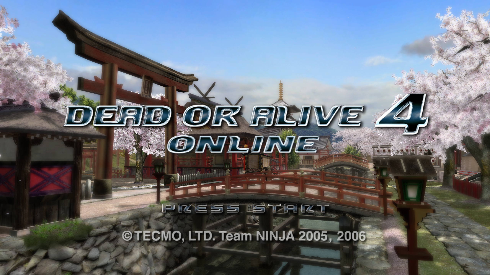
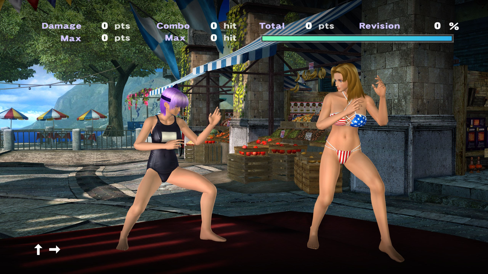
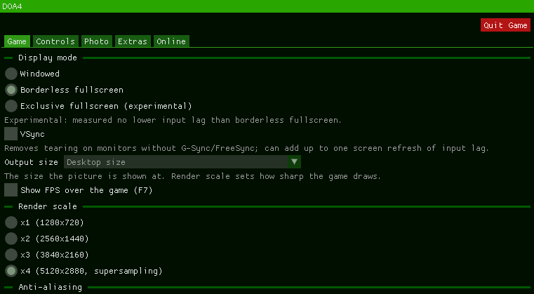

# Dead or Alive 4 Online

**Dead or Alive 4 Online** is a native Windows build of **Dead or Alive 4** (Xbox 360) with two-player
online play, statically recompiled with the [ReXGlue SDK](https://github.com/rexglue/rexglue-sdk). It
also builds **34 swimsuits from Dead or Alive Xtreme 2** (DOAX2) on your PC from your own disc, as extra
costumes. This is **alpha 0.3.3**: it works and is used, but it is still an alpha, and the
[known issues](#known-issues) are listed below. **No game data is included.** You need your own copy of
the game, and the swimsuits need your own DOAX2 disc.

It is a fork of [parkerallan/doa4-recomp](https://github.com/parkerallan/doa4-recomp), published at
[Dwreckgg/doa4-online](https://github.com/Dwreckgg/doa4-online). On top of it: two-player **online
play**, frame pacing, an Esc menu (Game / Controls / Photo / Extras / Online tabs), graphics and display
options (exclusive fullscreen, VSync, output size), the game's text language and subtitles saved between
starts, an option to skip the boot intro, a notice on the title screen when a new version is out,
full-quality photos, the DOAX2 swimsuits, and a first-run setup that finds or extracts the game files.
Building it yourself is for contributors: see [docs/BUILDING.md](docs/BUILDING.md).

## Easy setup: play online with a friend

You do not need to build anything. Each player does steps 1-3 once.

**What you need:** Windows 10 or 11, 64-bit; a CPU with AVX2 (Intel Haswell / AMD Zen or newer) and at
least two cores; the Microsoft Visual C++ 2015-2022 x64 runtime (if it is missing, the game stops with a "VCRUNTIME140.dll was not found" style error: install it from
[Microsoft's download page](https://learn.microsoft.com/cpp/windows/latest-supported-vc-redist));
your own copy of *Dead or Alive 4 (USA, Europe) (Rev 1)* as a disc image (`.iso`) or an extracted
folder; and, only for the swimsuits, your own **USA** copy of *Dead or Alive Xtreme 2*.

1. **Download the game program.** Open the
   [Releases page](https://github.com/Dwreckgg/doa4-online/releases), pick the newest `alpha-v...`
   release and download `DOA4-alpha-v...-win64.zip`. Both players must use the **same** release. If you
   already have an older copy, update it in the game instead: see [Updating](#updating).
2. **Unzip it** into a folder of its own, for example `C:\Games\Dead or Alive 4 Online` (plain letters,
   digits and spaces only in the path).
3. **Start `dead_or_alive_4.exe`.** The first time, the game shows its setup screen:

   

   - Pick your *Dead or Alive 4* disc image or an already extracted game folder, and it sets itself up
     (it shows the space needed and free, and a progress bar). No game data comes with the download.
   - **Optional: the DOAX2 swimsuits.** The setup then offers the swimsuits: pick your **USA** DOAX2 disc
     image (`.iso`) or its extracted folder. Nothing from DOAX2 is installed or downloaded: the game
     builds the swimsuits on your PC, which takes a few seconds on a recent PC, and writes about 300 MB
     into your saves folder (it needs about 364 MB free there). Press **Start without swimsuits** to
     skip it; you can import later from the Esc menu ([DOAX2 swimsuits](#doax2-swimsuits)).
4. **Connect.** In the game press **Esc** and open the **Online** tab.
   - The **host** presses **Host**, then **Copy** to copy the code, and sends it to the friend.
   - The **friend** pastes the code and presses **Join**.
   - **Windows Firewall:** when Windows asks, tick **both Private and Public** and allow the game
     (both players). If the prompt is hidden behind the game, press **Alt+Tab**.
5. **Play.** When both show *Connected*, the host presses **Start online session**. Both games
   restart into the session (host = player 1). At the title screen **only the host presses Start**, so the game loads the host's profile. The friend should not press anything until the menus appear: if the friend advances the title screen, the game can freeze for both players, and you then need to leave the session (**Leave online session**) and start a new one. Pick **Versus**, your characters and a stage, and
   fight. Everything is unlocked in a session and your own save is never changed.
6. **Finish.** **Leave online session** in the Online tab; both games restart offline.

**Can't connect?** On the host's router, turn on UPnP or forward **UDP port 7200** to the host's PC.
If the friend's game shows its own code while connecting, the host can type it under
**Strict router?** and press **Reach out**. More detail, and what each message means:
[Online play](#online-play-in-more-detail).

## Online play in more detail

**How it works:** online play links the two games so they play as if both players sat at one console. The host is player 1 and the friend is player 2 of an ordinary offline game (pick **Versus**, characters and a stage as you would at home), and each player's controller input is sent to the other PC. The game's own online mode (its Xbox Live menus) does not work: there are no Xbox Live lobbies, matchmaking or avatars. Connect through the Esc menu's **Online** tab instead.

**Language in a session:** both games use the host's text language and subtitles. Your own choice is not
changed, and it is back when the session ends.

**Slower PCs:** both games run at the speed of the slower PC. On a CPU with fewer cores (for example 4
cores) the game can slow down a lot when playing online. Online, avoid the CPU-heavy stages, such as
Savannah Safari and Experimental Playground, and avoid the DOAX2 swimsuits: they take more CPU than the
original DOA4 costumes.

Both players need the **same** release: the online handshake compares the compiled code, so two
different builds refuse each other. The releases are built by GitHub Actions and published as
pre-releases named `alpha-v<x.y.z>` on
[the Releases page](https://github.com/Dwreckgg/doa4-online/releases). A release holds the game's exe
and its two DLLs, never game data. `SHA256SUMS.txt` (in the zip and on the page) holds the SHA-256 of
the three files.

**Firewall (both players):** the first time you **Host or Join**, Windows asks whether to allow the game
through the firewall. Tick **both Private and Public networks**: Public is unticked by default, and a
Public network then blocks the connection. The prompt can hide behind the fullscreen game: press
**Alt+Tab**. If the other player still cannot connect, turn on UPnP in the host's router, or forward
UDP 7200 to the host PC.

**When the code does not connect:** the host's game asks the router to open its port (UPnP). If the
router does not, the host's tab offers **Strict router?** ("If the other player cannot connect, type
the code they show and press Reach out."); failing that, forward UDP port 7200 (DOA4 uses 7200-7215:
7200 unless another program holds it) on the host's router to the host PC. Some routers refuse a
mapping that expires after an hour; the game then asks for a permanent one. A permanent mapping stays
until the router restarts or you remove it in the router's own settings.

**What the messages mean:**

| Message | Meaning |
|---|---|
| "You have an older release (...): press Check for Updates, then restart the game." / "The other player has an older release (...): they need to press Check for Updates." | Two different releases: refused at the handshake. The older side updates. A copy from the old `netplay-v1.0.x` releases is always the older one, whatever its numbers; the message then shows both full tags. |
| "You run a self-built exe ..." / "The other player runs a self-built exe ..." | One game was built from source: both should use the latest release. On an old `netplay-v1.0.x` copy, "The other player runs a self-built exe" also appears when the other player has the alpha: press **Check for Updates**. |
| "The game files differ (...): both players need the same game files." | The named file groups of the two games' data differ. |
| "A direct connection is not possible between your networks; relay arrives with lobbies." | The routers change the port per destination (symmetric NAT), or every attempt to connect failed: the two PCs cannot reach each other directly yet. |
| "Waiting for the other player..." | The other player's input is late and the game holds. After 10 s: "The other player stopped responding. The session ended; both games restart." |
| "The games went out of sync. The session ended; both games restart." | A desync. Both games wrote diagnostics: send the session logs (below). |

**Session logs:** **Open session logs** in the Online tab opens `<saves folder>\netplay\sessions`
(the saves folder is the one the Game tab shows, [Saves, settings, photos and logs](#saves-settings-photos-and-logs)). After a
desync, send the newest session's folder.

## DOAX2 swimsuits

The game can build 34 swimsuits from *Dead or Alive Xtreme 2* as extra costumes for the girls. They
come after each character's own and extra costumes on the costume select screen, and you can pick them
straight away on any save.

- **You need your own USA copy of DOAX2**, as a disc image (`.iso`) or an extracted folder. Other
  pressings do not match and are refused as a wrong disc. Your *Dead or Alive 4* files must be the Rev 1
  files the game is set up with.
- **Where:** on the first start (the setup screen's optional step), or any time in the Esc menu: **Extras**
  tab, **Import DOAX2 swimsuits...** (it reads **Import again...** once you have them). It shows its
  progress and has **Cancel**.
- **How long, how much:** under a minute on a recent PC (3 to 9 seconds on the test PC, depending on how
  many threads it may use). It writes about 300 MB into a
  `doax2_suits` folder in your saves folder and needs about 364 MB free there while it works. Nothing
  else is written, and DOAX2 itself is only read.
- **Restart to use them.** When an import changes the suits, the result screen offers **Restart now**.
  Host and Join stay off until you restart.
- **Costumes:** importing also unlocks all the DOA4 costumes for the nine girls who have them. Your save
  isn't changed.
- **Full DOAX2 breast movement** (Extras tab) uses DOAX2's up-and-down range instead of the character's
  DOA4 range. It takes effect at once.

**Online with swimsuits:**

- A player with the suits keeps them in a session. If the other player does not have them, that player
  sees **COS. 1** for those costumes.
- A session where only one player has the suits has weaker protection against the two games drifting
  apart (a desync). The Online tab says who has them (*Swimsuits: both*, *only you*, *only the other
  player*, or *neither player*).
- Two players without the swimsuits play exactly as before.
- Two imports made by different versions of the importer count as different imports.

## Updating

When a new release is out, press **Check for Updates** in the Online tab of the Esc menu: it shows the
newest release, downloads its three files, checks each against its `SHA256SUMS.txt`, swaps them in, and
asks you to restart. Press it again if it says to. It is off while you are online. Both players need the
same release. You can also download the new zip and unzip it over the old folder.

When a newer release is out, the title screen also says so ("Update available:" with its version number)
until you press Start. It only tells you and downloads nothing; turn it off in the Online tab with **Tell me
about new versions at start-up**.

- **The launcher is retired for now.** The DOA4 launcher is not shipped with the releases any more, and its
  Update button should no longer be used: start `dead_or_alive_4.exe` and use **Check for Updates**. It may come
  back later.
- **Copies from the old `netplay-v1.0.x` releases** (v1.0.7, v1.0.9 and so on): press **Check for
  Updates** once. A last bridge release on the old channel carries the alpha build, and from then on the
  game follows the `alpha-v...` releases.

## The Esc menu and hotkeys

Press **Esc** at any time in the game to open the menu, and **Esc** again (or **Close (Esc)** at the
bottom) to close it. Your choices are saved to `dead_or_alive_4.toml` next to the exe and come back on
the next start. The menu has five tabs: **Game**, **Controls**, **Photo**, **Extras** and **Online**.

**Game**, from the top:
- **Display mode:** Windowed, Borderless fullscreen, or Exclusive fullscreen (experimental). The note
  under it: "Experimental: measured no lower input lag than borderless fullscreen."
- **VSync** (off unless you turn it on): "Removes tearing on monitors without G-Sync/FreeSync; can add up
  to one screen refresh of input lag."
- **Output size:** the size of the window in Windowed, the monitor mode in Exclusive fullscreen, and
  always the desktop size in Borderless fullscreen. "The size the picture is shown at. Render scale sets
  how sharp the game draws."
- **Show FPS over the game (F7).**
- **Render scale:** x1 (1280x720), x2 (2560x1440), x3 (3840x2160) or x4 (5120x2880, supersampling).
  It takes effect after a restart: until then the tab says "Applies after a restart (running at x1)."
  (with the scale the game runs at), and **Restart now** restarts the game for you.
- **Anti-aliasing:** Off, FXAA or FXAA Extreme. "The game uses 2x MSAA; FXAA Extreme suits it best. FXAA
  also softens text a little."
- **Texture filtering:** Off, 2x, 4x, 8x or 16x. "Applies to textures as the game draws them; you may
  see it after the next screen loads."
- **Speakers:** Automatic, Stereo or 5.1 surround. "Automatic follows Windows: 5.1 when the speakers are
  set to 5.1 or more, stereo otherwise. 5.1 surround always sends six channels." It takes effect after a
  restart: until then the tab says "Applies after a restart (running on Automatic)." (with the choice
  the game runs on) and offers **Restart now**. **Output device** under it shows how many channels your
  device has and what the game is sending.
- **Language:** the game's text language: English, Japanese, French, German, Italian, Spanish,
  Traditional Chinese or Korean. Your pick is applied to the running game and kept for the next start.
  The text language and subtitles you choose on the game's own options screen are kept the same way.
- **Start-up:** **Skip the intro at start-up** (off unless you turn it on): "Starts at the title screen.
  Applies at the next start."
- **Game files:** the folder the game runs from, with **Change...** to pick another and **Open
  folder**. "A new location is used from the next start."
- **Saves:** the folder that holds your saves and shader cache.

The top of the Game tab:

**Controls**
- **Controller:** pick **Player 1** to **Player 4**, then click a button in the list and press the
  controller button you want for it (Esc cancels). **Reset Player N** restores the default layout.
  Remapping needs the SDL input backend (`input_backend = sdl`).
- **Keyboard:** **Use keyboard as controller** turns keyboard play on. Choose which player the
  keyboard is (**P1** to **P4**), click an action and press the key you want for it; **Reset keyboard**
  restores the defaults. Esc opens the menu, so the keyboard's Start is Enter.

**Photo**
- **F12** saves a photo of the game's own frame at the render scale, without any overlay.
- **Format:** PNG at monitor size (the default), PNG at full render size, or JPG at full render size.
- **Folder:** where photos go (default `Pictures\DOA4`): **Choose folder...**, **Open folder**, and
  **Use default** to go back to the default.
- **In-game snapshots:** "Also save a full-quality copy when you save a snapshot to the in-game Album"
  saves a full-quality copy of every snapshot you save in the game's own photo mode (the game's Album
  keeps a small, compressed copy).
  

**Extras**
- **Unlocks:** Unlock all characters, Unlock all costumes, Unlock all system voices, Unlock all
  stages, or Unlock everything. Load your profile first (reach the main menu). Before the first unlock
  the game backs up your save, and the tab shows where.
- **Game tweaks:** "All stages in Tag battle" and "Hidden characters in multiplayer select".
- **Extra costumes:** "Helena's opera dress", "Kokoro's pink and blue kimonos" and "Christie's cutscene
  costume", added after each character's own costumes.
- **Wipe unlocks...** locks everything again, as in a new save, after it asks; a backup of your save is
  made first.
- **DOAX2 swimsuits:** **Import DOAX2 swimsuits...** (or **Import again...**), then **Restart now** to
  use them; see [DOAX2 swimsuits](#doax2-swimsuits).

**Online**
- **Play with a friend:** **Host** shows **Your code** (**Copy** puts it on the clipboard); the other
  player types it and presses **Join**. The tab then shows the connection and the ping. The host
  presses **Start online session** to begin, and **Leave online session** ends it. **Disconnect**
  stops hosting or drops the connection before a session starts.
- **Input delay:** **Auto**, or **Manual** with a slider from 1 to 8 frames. The host's choice applies
  to both players.
- **Strict router?:** if the other player cannot connect, type the code their game shows and press
  **Reach out**.
- **Show ping and input delay over the game (F9).**
- **Check for Updates** downloads the newest release, and **Open session logs** opens the folder of
  online session logs. **About** shows which version you run.
- **Tell me about new versions at start-up** (on unless you turn it off): when a newer release is out,
  the title screen shows "Update available:" with its version number (for example "Update available:
  0.3.2") until you press Start. It only tells you; **Check for Updates** does the download.

During an online session some options are locked so both games stay identical: the Extras tab, options
that need a restart, the language, and changing the game folder. Settings changed during a session are
restored when it ends.

**Hotkeys**

| Key | What it does |
|---|---|
| **Esc** | Opens and closes the menu |
| **F12** | Saves a photo |
| **F7** | Shows the frames per second |
| **F9** | Shows the online ping and input delay |
| **F6** | Shows the diagnostics overlay |
| **F8** | Online: marks the moment of a sound or timing glitch in the session log (send the log with your report) |

## Saves, settings, photos and logs

- **Saves and the shader cache** go to the folder in `doa4_user_data` in `dead_or_alive_4.toml` (for
  example `doa4_user_data = "C:/Games/DOA4saves"`, with forward slashes), else to
  `Documents\dead_or_alive_4`. Keep it outside OneDrive if you can (OneDrive can lock files the game is
  writing). The Esc menu's Game tab shows the folder in use. The imported swimsuits are in its
  `doax2_suits` folder.
- **Settings** live in `dead_or_alive_4.toml` next to the exe; the **Esc** menu edits them.
- **Photos** go to `Pictures\DOA4` unless the Photo tab says otherwise (**Open folder** opens it).
- **Logs:** `logs\dead_or_alive_4_NNN.log` next to the exe. Send the newest one with a bug report.
- **Online session logs:** **Open session logs** in the Online tab ([Online play in more detail](#online-play-in-more-detail)).

## Linux

Linux is not officially supported yet. One player reports that under Proton and Wine (GE-Proton11-12) the game does not
open as intended: it shows only a black screen. They could still join an online session with another player, and after
that the game ran fine. Solo offline play does not seem to work under Linux for now.

## Troubleshooting

| Symptom | Cause and fix |
|---|---|
| The game does not start | Check the newest log in `logs\` (lines tagged `[doa4][SETUP]` say which game folder was used and why). |
| The game does not start after Check for Updates | Rename `dead_or_alive_4.exe.old` back to `dead_or_alive_4.exe` (and the same for a `.dll.old`), or unzip the newest release over the folder. |
| The setup screen keeps coming back | The saved location could not be written to `dead_or_alive_4.toml` (the log says why), or the folder has moved. |
| "This path has characters that this build cannot use" | The game folder's path has characters outside the Windows code page (for example Japanese on an English Windows); the runtime cannot start from it. Use a folder whose path has plain letters and digits. |
| "This folder holds an unfinished extraction" | An earlier extraction was interrupted (the game was killed or the PC lost power). Delete that folder and extract again. |
| "Needs your own USA copy of DOAX2: this disc's files are not the ones the swimsuits are built from. Nothing was changed." | The disc is not the USA pressing of Dead or Alive Xtreme 2 (another region or another game). Pick your USA disc image or its extracted folder. |
| "Your DOA4 game files are not the Rev 1 files the swimsuits are built from. Nothing was changed." | The *Dead or Alive 4* files the game runs from are not the USA, Europe Rev 1 ones. Point the Game tab at Rev 1 files. |
| "Needs 364 MB free in (your saves folder); (some number) MB free. Nothing was changed." | The saves folder's drive is too full. Free the space (about 364 MB), or move the saves folder (`doa4_user_data`). |
| "Cannot write to (your saves folder). Nothing was changed." | The saves folder is read-only or protected. Choose another saves folder (`doa4_user_data`) or fix its permissions. |
| "The disc could not be read (...). Nothing was changed." | The disc image or the folder is damaged, or was moved or unplugged during the import. Check it and try again. |
| "The import failed (...). Nothing was changed." | Something unexpected stopped the import. Send the newest log from `logs\`. |
| "Import cancelled. Nothing was changed." / "The import is offered again at the next start." | You cancelled, or the game was closed during the import. The game offers the import again at the next start; **Start without swimsuits** skips it. |
| "The swimsuits are ready. They are put in place when the game next starts." | The game still held the files, so the swap waits. Restart the game. |
| "No swimsuit could be built:" or "33 swimsuits imported, 1 skipped:" (the numbers vary) | The lines under it say which suit was skipped and why. Send the log from `logs\` if you want it looked at. |
| "N of them differ from the reference build on this PC: they work, and online they count as a different import." | The swimsuits work, but their files are not byte for byte the ones the reference importer makes. In an online session they count as a different import (see Online with swimsuits above). |
| "These swimsuits were built by an older importer. Import them again to match players who have the new ones." | Your swimsuits come from an older version of the importer. **Import again...** in the Extras tab rebuilds them, so they match players who have the new ones. |
| "Restart the game to use them." | The import changed the suits. Press **Restart now**. |

## Known issues

| Issue | Status |
|---|---|
| A rare crash with `Call to invalid or unregistered function at guest address 0x...` in the log, at one particular move or moment. | A function the recompiler missed. Send the log (`logs\`) and say which move or moment, so it can be added in the next release. |
| The imported DOAX2 swimsuits still need polish: some show clipping, physics that don't look right, or visible seams in the models. | Being worked on in later releases. |
| Story mode: retrying a fight after a loss freezes the game for a couple of frames before the fight starts again. | A fix is planned. |
| The extra costumes (Esc menu, **Extras** tab: Helena's opera dress, Kokoro's pink and blue kimonos): reflections on the stage scenery show the character in a different costume. | A fix is planned. |
| First start with an extracted *Dead or Alive 4* folder: choosing it on the setup screen starts the game right away, before the optional DOAX2 swimsuit step. | Import the swimsuits any time from the Esc menu, **Extras** tab, **Import DOAX2 swimsuits...**. A fix is planned. |
| The profile / storage device screen on the first start hides the mouse pointer, which makes it awkward to click through. | A fix is planned: the screen should work with a controller or keyboard, or show the pointer. |
| The game's own online menus (Xbox Live) do not work. | Play online through the Esc menu's Online tab ([how it works](#online-play-in-more-detail)). |
| Online: if the joining player presses Start at the title screen, the session can freeze for both players. | Only the host should press Start; if it freezes, leave the session and start a new one. |
| Online: on a CPU with fewer cores (for example 4 cores) the game can slow down a lot, because both games run at the speed of the slower PC. | Avoid the CPU-heavy stages, such as Savannah Safari and Experimental Playground, when playing online. Avoid the DOAX2 swimsuits online too: they take more CPU than the original DOA4 costumes. |
| Untested so far (one PC only): the same swimsuits on two different PCs and a match with them over a real network; the frame rate with the swimsuits on a slower PC; other USA pressings of DOAX2 (they read as a wrong disc). | Reports welcome. |
| Linux (Proton / Wine): the game starts to a black screen instead of opening as intended (reported by one player on GE-Proton11-12). | Joining an online session with another player is reported to still work, and the game runs fine after that. Solo offline play does not seem to work yet. |

## Roadmap

Planned, no dates:

- Rollback netcode for online play.
- Online lobbies with up to 4 players.
- Costumes imported from other DOA titles, for example Dead or Alive 2 Ultimate (each from your own disc, as
  with DOAX2).
- A free camera / noclip mode.
- A toggle to show hitboxes and hurtboxes.

## Credits

- [parkerallan](https://github.com/parkerallan): the original
  [doa4-recomp](https://github.com/parkerallan/doa4-recomp) this is a fork of, and the DOA2U
  recompilation whose netplay layer this port's lobby, join codes and connection code are ported from.
- The ReXGlue SDK ([rexglue/rexglue-sdk](https://github.com/rexglue/rexglue-sdk)).
- Tekken 6 Native Online by Ekspym and mahmoud-mess
  ([Ekspym/tekken6-native-online-source](https://github.com/Ekspym/tekken6-native-online-source),
  [mahmoud-mess/tekken6-recomp](https://github.com/mahmoud-mess/tekken6-recomp)): the SDK fork's audio
  and XMA lockstep is theirs; also the main reference for the rollback-ready design.
- [GekkoNet](https://github.com/HeatXD/GekkoNet) by HeatXD (the input exchange) and
  [miniupnpc](https://github.com/miniupnp/miniupnp) by Thomas Bernard (the router port); licences in
  [THIRD_PARTY_NOTICES.md](THIRD_PARTY_NOTICES.md).
- [MK-3D-rollback](https://github.com/Jstackzz/MK-3D-rollback) by Jstackzz: studied for the lobby,
  rotation and hold-point design.
- Also studied for the rollback research, no code taken:
  [Project Slippi](https://github.com/project-slippi/Ishiiruka),
  [Flycast](https://github.com/flyinghead/flycast),
  [Xenia Canary netplay](https://github.com/AdrianCassar/xenia-canary) (AdrianCassar),
  [RMG-K](https://github.com/Jay-Day/RMG-K), [3SX](https://github.com/crowded-street/3sx) and
  [Giuroll](https://github.com/Hagb/giuroll).
- [sheikproject](https://github.com/sheikproject): the original Blender script to import models into
  DOA4 was found on the XeNTaX forums; it could load a basic armature and the models. sheikproject
  heavily modified and updated it, and the swimsuit converter's recipe is built on that version. The
  original script's author is not known.
- Thanks to everyone who helped playtest the online play.

The same names, and the licences of the code taken, are in [THIRD_PARTY_NOTICES.md](THIRD_PARTY_NOTICES.md).

## Contributing

Pull requests are welcome. To build the game yourself, see [docs/BUILDING.md](docs/BUILDING.md).

## Reporting bugs

Report bugs on the [Issues page](https://github.com/Dwreckgg/doa4-online/issues):

1. Search the open issues first. If yours is already there, add what you saw to it.
2. Otherwise press **New issue** and describe:
   - which release you run (the Esc menu's **About** shows it);
   - what you did, what you expected, and what happened instead;
   - whether it happened offline or online, and whether you have the DOAX2 swimsuits imported.
3. Attach the newest log, `logs\dead_or_alive_4_NNN.log` next to the exe. For a problem online, also
   attach the newest folder from **Open session logs** in the Online tab. Both players' logs help most.
4. Do not attach game files, disc images or anything extracted from them.

## License

This project is under the [MIT License](LICENSE). Third-party code keeps its own licenses, listed in
[THIRD_PARTY_NOTICES.md](THIRD_PARTY_NOTICES.md). No game data is included. You need your own copy of the game.

## AI disclosure

AI tools were used to help write and test the code and documentation of this branch, changes were tested before they were published.
